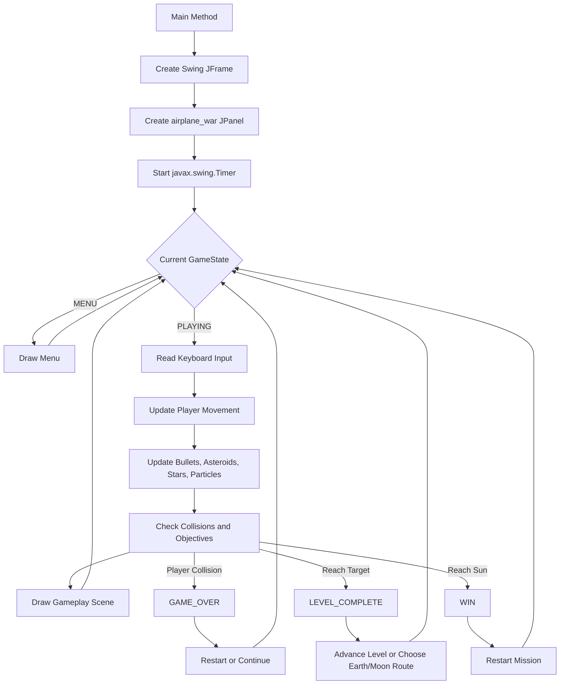

# ORBIT ZERO 🚀

> A Java-based 2D space shooter that combines arcade combat, Newtonian-style movement, procedural graphics, and a journey through the Solar System.

## Project Purpose

**ORBIT ZERO** is a Java final project designed to explore how a complete 2D game can be built with the standard Java platform and without external art assets.

The project focuses on:

- Applying object-oriented programming to game entities and game states.
- Simulating acceleration, deceleration, rotation, and inertia-like movement.
- Creating graphics, particle effects, and sound effects programmatically.
- Designing a multi-level space adventure with progression and a branching Earth/Moon route.
- Practicing real-time input handling, collision detection, rendering, and game-loop design.

## Technologies Used

- **Java**
- **Java Swing** for the application window and UI container.
- **Java 2D API (`Graphics2D`)** for procedural rendering.
- **Java AWT** for keyboard input, geometry, colors, gradients, and transforms.
- **Java Sound API (`javax.sound.sampled`)** for generated shooting and hit effects.
- **Object-oriented programming** with nested classes for bullets, asteroids, enemies, particles, and stars.
- **Finite state machine design** for menu, gameplay, game-over, level-complete, and victory states.

No API keys, passwords, or personal information are required by this project.

## Main Features

- **Physics-based spaceship movement**
  - Acceleration and braking.
  - Rotation using the left and right arrow keys.
  - Screen wraparound when the spaceship leaves the play area.

- **Combat system**
  - Fire projectiles with the `SPACE` key.
  - Destroy asteroids and track shots, hits, and accuracy.
  - Asteroids split into smaller objects when destroyed.

- **Procedural visuals**
  - Spaceship, asteroids, bullets, planets, stars, and UI elements are drawn at runtime.
  - Particle effects are used for engine exhaust and explosions.
  - Saturn includes a special ring-like small-asteroid effect.

- **Solar System progression**
  - Travel through a sequence of destinations including Neptune, Uranus, Saturn, Jupiter, Mars, Earth, the Moon, Venus, Mercury, and the Sun.
  - Targets become available after the area has been cleared for a period of time.

- **Branching route**
  - At the Earth choice level, the player can travel to the Moon or continue toward Earth.

- **Game states and progression**
  - Main menu.
  - Playing state.
  - Level completion screen.
  - Game-over screen with statistics.
  - Victory screen with collected journey souvenirs.

- **Programmatically generated audio**
  - Shooting and hit sounds are synthesized from sine waves instead of external audio files.

## Controls

| Key | Action |
| --- | --- |
| `Enter` | Start the game, continue to the next level, or restart after victory |
| `Up Arrow` | Accelerate / thrust |
| `Down Arrow` | Brake / move backward |
| `Left Arrow` | Rotate left |
| `Right Arrow` | Rotate right |
| `Space` | Fire |
| `R` | Restart after game over |
| `C` | Continue from the current level after game over |

## Installation and Running

### Requirements

- **JDK 8 or later**
- A desktop environment capable of running Java Swing
- A keyboard for gameplay

### Clone the repository

```bash
git clone https://github.com/Athenahhw/orbit_zero.git
cd orbit_zero
```

### Compile

The main source file is located at the repository root:

```bash
javac airplane_war.java
```

### Run

```bash
java airplane_war
```

The game opens in a maximized Swing window. Press `Enter` on the title screen to begin.

### Clean compiled files

The repository may contain generated `.class` files. To remove locally generated class files before recompiling:

```bash
find . -name "*.class" -delete
```

On Windows PowerShell, use:

```powershell
Get-ChildItem -Recurse -Filter *.class | Remove-Item
```

## System Architecture

The game is implemented as a single Java application with a real-time update and rendering loop.



### Main Components

- **Game state manager**: Controls the menu, active gameplay, level transitions, game over, and victory screens.
- **Input manager**: Uses `KeyListener` to track movement, firing, restart, and level progression commands.
- **Game update loop**: A Swing `Timer` triggers updates approximately every 16 milliseconds.
- **Entity collections**: `ArrayList` objects manage bullets, asteroids, enemies, particles, stars, and Saturn's small asteroids.
- **Collision and objective system**: Detects projectile impacts, player collisions, target arrival, and level completion.
- **Rendering system**: Uses `Graphics2D`, gradients, alpha blending, transforms, and geometric shapes to draw each frame.
- **Audio system**: Generates short sound effects with `AudioFormat` and `SourceDataLine`.

## App Screen / Demo

The application currently renders its screens directly from Java code rather than using external image files. The main playable flow is:

1. **Title screen** — displays the `ORBIT ZERO` title and controls.
2. **Gameplay screen** — shows the spaceship, stars, asteroids, bullets, particles, target planet, progress bar, and status panel.
3. **Level complete screen** — displays the newly collected souvenir and the next-level prompt.
4. **Game-over screen** — displays destroyed asteroids, total shots, accuracy, and the reached level.
5. **Victory screen** — displays the collected journey souvenirs after reaching the Sun.

To see the live demo, compile and run the project using the commands above. The visual implementation can be inspected in [`airplane_war.java`](airplane_war.java), especially the `drawMenu`, `drawGame`, `drawGameOver`, `drawLevelComplete`, and `drawWin` methods.

## My Contributions

My main responsibilities in this project included:

- Designing and implementing the core Java Swing game application.
- Building the real-time game loop and game-state flow.
- Implementing spaceship movement, acceleration, rotation, braking, and screen wraparound.
- Developing projectile, asteroid, collision detection, and level-progression logic.
- Creating procedural graphics with Java 2D instead of relying on external sprites.
- Implementing particle effects for engine exhaust and explosions.
- Designing the Solar System route and Earth/Moon branching level.
- Implementing the HUD, menus, game-over screen, level-complete screen, and victory screen.
- Generating basic sound effects programmatically with the Java Sound API.
- Tracking gameplay statistics such as shots fired, hits, accuracy, and destroyed asteroids.

## Known Limitations

- The game is currently contained mainly in one Java source file, which makes long-term maintenance more difficult.
- There is no build tool configuration such as Maven or Gradle.
- There are no automated unit tests or integration tests yet.
- The game currently supports keyboard input only.
- The visuals are procedural and intentionally simple; there are no external sprite or animation assets.
- Audio behavior may vary across operating systems and audio devices.
- Enemy behavior is present in the code structure but is not yet integrated into a complete enemy spawning and combat loop.
- The game has limited configuration options for resolution, difficulty, audio, and controls.
- The current collision system uses simple distance checks rather than more precise shape-based collision detection.

## Future Improvements

- Separate the application into packages and individual classes such as `Player`, `Enemy`, `Asteroid`, `Projectile`, `ParticleSystem`, `Renderer`, and `GameStateManager`.
- Add Maven or Gradle support for easier compilation and dependency management.
- Add automated tests for movement, collisions, score calculation, and level transitions.
- Improve enemy spawning, enemy projectiles, and enemy AI behaviors.
- Add a pause menu, settings screen, configurable controls, and volume controls.
- Add save data for progress and high scores.
- Improve collision accuracy with geometric bounds or hitbox components.
- Add more visual effects, animations, and accessibility options.
- Package the game as an executable JAR or native desktop application.
- Add screenshots or a recorded gameplay demo to the repository.

## Project Structure

```text
orbit_zero/
├── airplane_war.java       # Main game source file
├── src/                     # Additional source directory, if extended in future versions
├── README.md                # Project documentation
└── *.class                  # Generated Java bytecode files, when compiled
```

## Privacy and Security

This project does not require API keys, passwords, environment secrets, or personal data. Do not commit credentials, private configuration files, or personal information to the repository.

## License

No license has been specified for this repository yet. Add a license file if you plan to distribute or reuse the project publicly.
